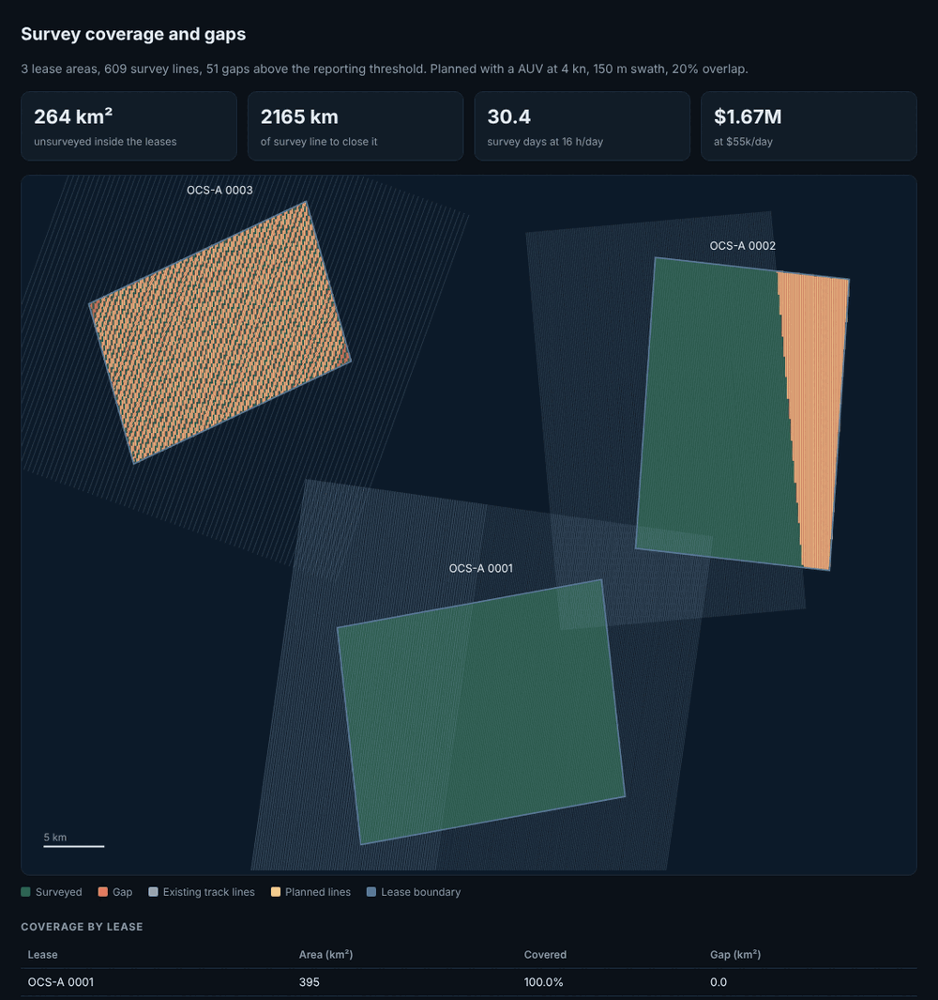

# offshore-survey-gap-map

Find the parts of an offshore lease area that nobody has surveyed, and work
out what it costs to close them: survey lines, hours, days and dollars.



> Independent project. Not affiliated with or endorsed by Bedrock. The real
> inputs are public (BOEM publishes wind lease shapefiles; NOAA NCEI holds
> survey coverage), but neither is redistributed here, so the repository ships
> generated sample data with the same shape. Both loaders read GeoJSON, so
> pointing this at real exports is a file path.

## Why this, for Bedrock

Bedrock's case is that an autonomous, data-first survey beats a vessel-days
procurement. That argument is won with numbers: how much of a lease is
actually missing, how much of what exists is too old or the wrong sensor to
count, and what closing the gap costs. Those numbers are not in any single
dataset. They come from intersecting lease boundaries with the coverage of
every past survey, and then from planning the lines that would fill what is
left.

This tool does that end to end, and the output is the artifact a developer
actually argues over: a map with a cost on it.

## What it produces

```
$ gapmap report --cell 100 --min-gap 0.5

3 lease(s), 609 survey line(s), 100 m grid

lease           area km2   covered   gap km2  gaps
OCS-A 0001           395    100.0%       0.0     0
OCS-A 0002           384     74.4%      98.3     1
OCS-A 0003           266     37.5%     166.1    50

lease           gap km2  heading  lines  line km  turn km  hours   km2/h
OCS-A 0002         98.3       0°     50      818       36  115.4    0.85
OCS-A 0003          2.2      15°     23       17       16    4.5    0.49
OCS-A 0003          1.0      15°     11        8        7    2.0    0.48
...

total: 263 km2 of gap, 2167 km of line, 490 survey hours = 30.6 days = $1.68M
```

The three sample leases carry the three failure modes that actually show up:

- **OCS-A 0001** was surveyed properly and is clean.
- **OCS-A 0002** had a survey that stopped two thirds of the way through, so a
  quarter of the lease is one large contiguous hole.
- **OCS-A 0003** was run at 400 m line spacing with a 150 m swath, so the
  "surveyed" lease is 37.5% covered and the missing 166 km² is 50 thin
  stripes. This is the expensive one: the same area as a single hole, but at
  roughly half the square kilometres per hour, because thin gaps are mostly
  turns.

That last row is the point of putting a cost model next to the map. Gap area
alone would rank these two leases as similar; survey hours do not.

## What it does

```
gapmap/
  geo.py        Sinusoidal local projection, polygon area, point-in-polygon, segment distance
  model.py      Lease areas, survey lines, coverage grids, gaps, plans, vessel parameters
  coverage.py   Rasterize leases and swaths, filter by sensor and year, find connected gaps
  plan.py       Lawnmower line planning with heading search, turn cost, prioritization
  io.py         GeoJSON in and out, with BOEM property names
  render.py     Self-contained HTML map, inline SVG, no tiles and no network
  sample.py     Generated lease areas and surveys
  cli.py        report / sample
```

### Coverage as a raster problem

Once the geometry is projected to metres the whole analysis is a raster
question: mark the cells inside the lease, mark the cells within half a swath
of any qualifying track, and the gap is what is left, split into connected
components. Raster rather than exact polygon clipping because the question is
"how many square kilometres are missing and where", not "what is the exact
boundary of the uncovered region".

**Coverage is a query, not a fact.** `--sensor` and `--since` change what
counts: "which parts have no magnetometer coverage since 2020" is a different
map from "which parts have never been surveyed", and the difference is what
decides whether a vessel sails.

### Choosing the heading, not assuming it

Turns are where survey time goes: a six-minute turn on a 2 km line is a fifth
of the line's own duration. The planner tries headings over 180 degrees (a
lawnmower pattern is symmetric) and keeps the fastest. On a long thin gap it
reproduces the obvious answer, running lines along the gap; on an awkward one
it beats a fixed north-south grid. Lines are clipped to the cells that are
actually missing, and a line crossing an already-covered strip is split rather
than run across it.

Plans are ranked by square kilometres closed per survey hour, which is the
number that decides what a vessel does first.

### Two things the tests pinned down

- **Grid resolution has to be finer than the feature.** The total missing area
  converges fast: every grid from 400 m down agrees on OCS-A 0003's 166 km² to
  within a percent. The *segmentation* does not. At 400 m the 250 m stripes
  merge into blobs (20 gaps), at 200 m they touch diagonally and merge into
  two, and only from 150 m down is the answer stable at 50. If the output is a
  number, a coarse grid is fine; if it is a work plan, it is not.
- **One projection for the whole study.** Grids carry coordinates in projected
  metres, so two leases built on their own local projections cannot be drawn
  on one map or compared. An early version did exactly that, and the map was
  the thing that showed it: lease coverage drawn tens of kilometres from the
  lease. `shared_projection` now takes every lease in the study.

The projection's distortion is measured rather than assumed: under 0.07%
within a lease and under 0.15% across a group of them, pinned by a test so a
change cannot quietly make it worse. The projection is equal-area, which
matters because area is what this tool reports.

## Running it

Requires Python 3.11 or newer. Only dependency is numpy.

```bash
python -m venv .venv && source .venv/bin/activate
pip install -e ".[dev]"

gapmap report --cell 100 --html out/map.html --geojson out/
gapmap report --sensor magnetometer --since 2018      # a different question
gapmap report --swath 200 --speed 5 --day-rate 80000  # a different vessel
gapmap sample --out data/                             # write the sample inputs as GeoJSON
pytest
```

### Using real data

```bash
gapmap report --leases boem_wind_leases.geojson --lines ncei_tracks.geojson --cell 100
```

`load_leases` reads Polygon and MultiPolygon features and understands BOEM's
property names (`LEASE_NUMBER`, `COMPANY`) with generic fallbacks.
`load_lines` reads LineString and MultiLineString features and takes
`swath_m`, `survey`, `year` and `sensor` from the properties when they are
there. A shapefile converts with `ogr2ogr -f GeoJSON out.geojson in.shp`.

Outputs are GeoJSON too (`--geojson`), so the gaps and planned lines go
straight into whatever the survey team already uses.

## Tests

28 tests, no network. They cover the geometry primitives against hand-computed
answers (square areas, an L-shaped polygon, segment distance clamping at the
endpoints, a degenerate segment), the projection's distortion bounds and its
equal-area property, grid area against polygon area, a single line covering a
swath-wide strip, sensor and year filtering, connected components, gap
ordering and size filtering, the resolution convergence described above,
heading selection beating a fixed heading, turn cost growing with line count,
line splitting across covered water, cost scaling with the day rate,
GeoJSON round-tripping including MultiPolygon and BOEM property names, and
that the rendered page contains no network references.

## Limitations

- Coverage is binary. Real survey data has quality: a line run in bad weather
  may technically cover a cell without being usable. A quality score per line,
  with a threshold, is the obvious next field.
- The planner lays straight parallel lines. It does not avoid obstructions,
  respect exclusion zones, or plan transits between gaps, all of which a real
  campaign needs.
- Cost is a day rate times survey days. Mobilization, weather downtime and
  transit from port are not modeled, and on a short campaign they dominate.
- Gaps are reported with bounding boxes in GeoJSON rather than exact
  outlines, which is enough to plan against but not to publish.

## License

MIT
